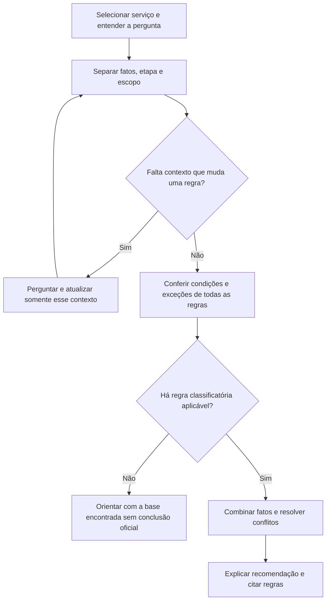

# Regras de Repavimentação Asfalto

Base 2.20.0. Gerado da fonte única; não edite este resumo para alterar uma regra.

Perfil: Repavimentação Asfalto. 2 serviços e 39 regras/orientações aplicáveis.

As duas faixas compartilham regras. A aplicação continua vinculada ao serviço selecionado.

## Fluxo geral



Consulta e hipótese explicam possibilidades; não classificam uma OS real. BGE relaciona linguagem, não confirma fatos.

## Como manter

Edite `src/data/rulesStore.json`. `python/catalogProfile.json` só seleciona o escopo, sem conter decisões. Depois execute `python/export_rulebook.py` e os testes.

## Critério vigente

A retificação confirmada pelo responsável em 03/11/2026 está incorporada à base 2.20.0. Consulte as condições de equipe nas regras de trena e de aferição abaixo. Sem esse contexto, a orientação deve pedir esclarecimento. O histórico anterior não prevalece sobre esta revisão da fonte única.


## Adicional executado


### Evidências próprias do adicional executado

```text
RULE-GERAL-EVID-02 | Evidências próprias do adicional executado

Cada adicional ou desdobro executado é um serviço realizado e precisa ter sua própria sequência de antes, execução e resultado final.

CONCLUSÃO: Orientação, sem conclusão oficial
ONDE SE APLICA: Conforme o serviço selecionado

ORIENTAÇÃO: Não considere a simples marcação no sistema como prova. Confira a cadeia fotográfica do original e, separadamente, a de cada adicional executado.

EXEMPLOS: O reparo de ramal foi lançado no executado, mas não mostrou fazendo.; O desdobro executado ficou sem foto durante.

BASE INFORMADA: Diretriz de análise informada pelo responsável do projeto em 14/08/2026; Conjunto de ITs operacionais recebido em 14/08/2026
```


## Adicional posterior


### Justificativa do adicional posterior

```text
RULE-GERAL-EVID-03 | Justificativa do adicional posterior

O adicional posterior representa trabalho ainda necessário e deve estar apoiado por imagem ou fato que mostre por que ele precisa ser programado.

CONCLUSÃO: Orientação, sem conclusão oficial
ONDE SE APLICA: Conforme o serviço selecionado

ORIENTAÇÃO: Confirme se há uma evidência objetiva da necessidade e se o tipo de serviço posterior corresponde ao problema mostrado.

EXEMPLOS: Lançou repavimentação no posterior, mas não mostrou o local que precisa dela.

BASE INFORMADA: Diretriz de análise informada pelo responsável do projeto em 14/08/2026; Conjunto de ITs operacionais recebido em 14/08/2026
```


## Aferição da vala


### Tipo de equipe necessário quando falta aferição da vala

```text
RULE-PAV-AFERICAO-CONTEXTO-01 | Tipo de equipe necessário quando falta aferição da vala

A ação para falta de aferição em uma OS original de reaterro ou repavimentação depende de a equipe executora ser interna ou terceirizada.

CONCLUSÃO: Orientação, sem conclusão oficial
ONDE SE APLICA: OS atual
EXCEÇÃO A CONFERIR NO RELATO: equipe interna
EXCEÇÃO A CONFERIR NO RELATO: equipe própria
EXCEÇÃO A CONFERIR NO RELATO: funcionário da empresa
EXCEÇÃO A CONFERIR NO RELATO: equipe terceirizada
EXCEÇÃO A CONFERIR NO RELATO: equipe terceira
EXCEÇÃO A CONFERIR NO RELATO: empreiteira
EXCEÇÃO A CONFERIR NO RELATO: contratada
EXCEÇÃO A CONFERIR NO RELATO: interna
EXCEÇÃO A CONFERIR NO RELATO: terceirizada
EXCEÇÃO A CONFERIR NO RELATO: adicional executado
EXCEÇÃO A CONFERIR NO RELATO: desdobro executado
SE FALTAR CONTEXTO, PERGUNTAR: A equipe que executou esse serviço é interna ou terceirizada?
INFORMAÇÃO IMPORTANTE: A equipe que executou o serviço é interna ou terceirizada?

ORIENTAÇÃO: Informe o tipo de equipe antes de concluir: equipe interna gera Não Conforme com retrabalho; equipe terceirizada gera Reprovação.

EXEMPLOS: A OS de repavimentação está sem aferição da vala. O que faço?

BASE INFORMADA: Regra de análise informada pelo responsável do projeto em 31/08/2026
```


### Falta de aferição em serviço original executado por equipe interna

```text
RULE-PAV-AFERICAO-INTERNA-01 | Falta de aferição em serviço original executado por equipe interna

Quando uma equipe interna executa Reaterro ou Repavimentação sem comprovar a aferição da vala, a OS recebe Não Conforme e deve gerar retrabalho.

CONCLUSÃO: Não Conforme
ONDE SE APLICA: OS atual
CONFIRMAR: equipe interna
CONFIRMAR: tipo de equipe confirmado (equipe interna ou equipe própria ou funcionário da empresa ou equipe da empresa ou pessoal próprio ou interna)
EXCEÇÃO A CONFERIR NO RELATO: equipe terceirizada
EXCEÇÃO A CONFERIR NO RELATO: equipe terceira
EXCEÇÃO A CONFERIR NO RELATO: empreiteira
EXCEÇÃO A CONFERIR NO RELATO: contratada
EXCEÇÃO A CONFERIR NO RELATO: adicional executado
EXCEÇÃO A CONFERIR NO RELATO: desdobro executado
EXCEÇÃO A CONFERIR NO RELATO: aferição apresentada
EXCEÇÃO A CONFERIR NO RELATO: aferição da vala foi apresentada
EXCEÇÃO A CONFERIR NO RELATO: aferição foi apresentada
EXCEÇÃO A CONFERIR NO RELATO: aferição comprovada
EXCEÇÃO A CONFERIR NO RELATO: medição comprovada

ORIENTAÇÃO: Registre a OS como Não Conforme e gere o Retrabalho do mesmo Reaterro ou da mesma Repavimentação para execução com aferição comprovada.

EXEMPLOS: A equipe interna fez a repavimentação, mas não mostrou a aferição da vala.

BASE INFORMADA: Regra de análise informada pelo responsável do projeto em 31/08/2026
```


### Falta de aferição em serviço original executado por equipe terceirizada

```text
RULE-PAV-AFERICAO-TERCEIRA-01 | Falta de aferição em serviço original executado por equipe terceirizada

Quando uma equipe terceirizada executa Reaterro ou Repavimentação sem comprovar a aferição da vala, a OS deve ser reprovada.

CONCLUSÃO: Reprovado
ONDE SE APLICA: OS atual
CONFIRMAR: equipe terceirizada
CONFIRMAR: tipo de equipe confirmado (equipe terceirizada ou equipe terceira ou terceirizada ou empreiteira ou contratada)
EXCEÇÃO A CONFERIR NO RELATO: equipe interna
EXCEÇÃO A CONFERIR NO RELATO: equipe própria
EXCEÇÃO A CONFERIR NO RELATO: funcionário da empresa
EXCEÇÃO A CONFERIR NO RELATO: adicional executado
EXCEÇÃO A CONFERIR NO RELATO: desdobro executado
EXCEÇÃO A CONFERIR NO RELATO: aferição apresentada
EXCEÇÃO A CONFERIR NO RELATO: aferição da vala foi apresentada
EXCEÇÃO A CONFERIR NO RELATO: aferição foi apresentada
EXCEÇÃO A CONFERIR NO RELATO: aferição comprovada
EXCEÇÃO A CONFERIR NO RELATO: medição comprovada

ORIENTAÇÃO: Reprove a Ordem de Serviço e registre a ausência da aferição obrigatória da vala.

EXEMPLOS: A terceirizada fez o reaterro sem mostrar a aferição da vala.

BASE INFORMADA: Regra de análise informada pelo responsável do projeto em 31/08/2026
```


## Aferição de adicional executado


### Tipo de equipe necessário para corrigir adicional executado sem aferição

```text
RULE-PAV-AFERICAO-ADICIONAL-CONTEXTO-01 | Tipo de equipe necessário para corrigir adicional executado sem aferição

Quando Reaterro ou Repavimentação aparece no Adicional Executado sem aferição da vala, a correção depende de a equipe ser interna ou terceirizada.

CONCLUSÃO: Orientação, sem conclusão oficial
ONDE SE APLICA: Adicional Executado
EXCEÇÃO A CONFERIR NO RELATO: equipe interna
EXCEÇÃO A CONFERIR NO RELATO: equipe própria
EXCEÇÃO A CONFERIR NO RELATO: equipe terceirizada
EXCEÇÃO A CONFERIR NO RELATO: equipe terceira
EXCEÇÃO A CONFERIR NO RELATO: terceirizada
EXCEÇÃO A CONFERIR NO RELATO: empreiteira
EXCEÇÃO A CONFERIR NO RELATO: contratada
SE FALTAR CONTEXTO, PERGUNTAR: A equipe que executou esse serviço é interna ou terceirizada?
INFORMAÇÃO IMPORTANTE: A equipe que executou o adicional é interna ou terceirizada?

ORIENTAÇÃO: Informe o tipo de equipe antes de concluir. A ação é diferente para equipe interna e terceirizada.

EXEMPLOS: A repavimentação está no Adicional Executado, mas não tem aferição da vala.

BASE INFORMADA: Regra de análise informada pelo responsável do projeto em 31/08/2026
```


### Adicional executado sem aferição por equipe interna

```text
RULE-PAV-AFERICAO-ADICIONAL-INTERNA-01 | Adicional executado sem aferição por equipe interna

Quando uma equipe interna lança Reaterro ou Repavimentação no Adicional Executado sem comprovar a aferição da vala, deve ser gerado o retrabalho correspondente no Adicional Posterior.

CONCLUSÃO: Não Conforme
ONDE SE APLICA: Adicional Executado
CONFIRMAR: equipe interna
CONFIRMAR: tipo de equipe confirmado (equipe interna ou equipe própria ou funcionário da empresa ou equipe da empresa ou pessoal próprio ou interna)
CONFIRMAR: posição do serviço confirmada (adicional executado ou desdobro executado ou no executado)
CONFIRMAR: serviço de pavimento confirmado (reaterro ou repavimentação)
EXCEÇÃO A CONFERIR NO RELATO: equipe terceirizada
EXCEÇÃO A CONFERIR NO RELATO: equipe terceira
EXCEÇÃO A CONFERIR NO RELATO: empreiteira
EXCEÇÃO A CONFERIR NO RELATO: contratada
EXCEÇÃO A CONFERIR NO RELATO: aferição apresentada
EXCEÇÃO A CONFERIR NO RELATO: aferição da vala foi apresentada
EXCEÇÃO A CONFERIR NO RELATO: aferição foi apresentada
EXCEÇÃO A CONFERIR NO RELATO: aferição comprovada
EXCEÇÃO A CONFERIR NO RELATO: medição comprovada

ORIENTAÇÃO: Registre Não Conforme e gere no Adicional Posterior o Retrabalho do mesmo Reaterro ou da mesma Repavimentação, exigindo a aferição da vala no retorno.

EXEMPLOS: A equipe interna colocou a Repavimentação no Adicional Executado, mas não aferiu a vala.

BASE INFORMADA: Regra de análise informada pelo responsável do projeto em 31/08/2026
```


### Adicional executado sem aferição por equipe terceirizada

```text
RULE-PAV-AFERICAO-ADICIONAL-TERCEIRA-01 | Adicional executado sem aferição por equipe terceirizada

Quando uma equipe terceirizada lança Reaterro ou Repavimentação no Adicional Executado sem comprovar a aferição da vala, o serviço deve ser retirado do Executado e lançado no Posterior.

CONCLUSÃO: Não Conforme
ONDE SE APLICA: Adicional Executado
CONFIRMAR: equipe terceirizada
CONFIRMAR: tipo de equipe confirmado (equipe terceirizada ou equipe terceira ou terceirizada ou empreiteira ou contratada)
CONFIRMAR: posição do serviço confirmada (adicional executado ou desdobro executado ou no executado)
CONFIRMAR: serviço de pavimento confirmado (reaterro ou repavimentação)
EXCEÇÃO A CONFERIR NO RELATO: equipe interna
EXCEÇÃO A CONFERIR NO RELATO: equipe própria
EXCEÇÃO A CONFERIR NO RELATO: funcionário da empresa
EXCEÇÃO A CONFERIR NO RELATO: aferição apresentada
EXCEÇÃO A CONFERIR NO RELATO: aferição da vala foi apresentada
EXCEÇÃO A CONFERIR NO RELATO: aferição foi apresentada
EXCEÇÃO A CONFERIR NO RELATO: aferição comprovada
EXCEÇÃO A CONFERIR NO RELATO: medição comprovada

ORIENTAÇÃO: Registre Não Conforme, remova o Reaterro ou a Repavimentação do Adicional Executado e lance o mesmo serviço no Adicional Posterior para execução futura com aferição.

EXEMPLOS: A terceirizada lançou o Reaterro no Adicional Executado sem mostrar a aferição da vala.

BASE INFORMADA: Regra de análise informada pelo responsável do projeto em 31/08/2026
```


## Duplicidade


### Serviço já executado em outra OS

```text
RULE-ASF-DUPLICIDADE-01 | Serviço já executado em outra OS

O Field ou o SCAE comprova que o mesmo serviço já foi executado em outra OS.

CONCLUSÃO: Reprovado
ONDE SE APLICA: OS atual
CONFIRMAR: sistema consultado para comprovar a duplicidade (Field ou SCAE)

ORIENTAÇÃO: Reprove e oriente o cancelamento por Duplicidade após conferir no Field/SCAE. Cancelamento é uma ação operacional, não outra conclusão oficial.

EXEMPLOS: serviço já executado em outra OS no Field

BASE INFORMADA: Repavimentação Asfalto atualizado.txt — fornecido por Pedro Lucas Botelho em 07/10/2026
```


## Evidência do serviço original


### Cadeia mínima de evidências do serviço original

```text
RULE-GERAL-EVID-01 | Cadeia mínima de evidências do serviço original

A análise deve conseguir ligar o local e a condição inicial à execução e ao resultado final do serviço original.

CONCLUSÃO: Orientação, sem conclusão oficial
ONDE SE APLICA: Conforme o serviço selecionado

ORIENTAÇÃO: Confira antes, durante e depois como uma sequência do mesmo local. Esta orientação não define sozinha uma conclusão oficial.

EXEMPLOS: O serviço original não mostrou todas as etapas.; Quais fotos o serviço original precisa ter?

BASE INFORMADA: Diretriz de análise informada pelo responsável do projeto em 14/08/2026; Conjunto de ITs operacionais recebido em 14/08/2026
```


## Evidência fotográfica


### Falta de foto antes da repavimentação

```text
RULE-ASF-FOTO-ANTES-01 | Falta de foto antes da repavimentação

As fotos antes mostram a condição inicial da vala ou do local, antes de começar o trabalho. Se esse estado inicial não foi registrado, pontue qualidade fotográfica.

CONCLUSÃO: Não Conforme
ONDE SE APLICA: OS atual
NÃO APLICAR NESTE CONTEXTO: execução em andamento ou resultado final

ORIENTAÇÃO: Registre Não Conforme por Qualidade Fotográfica: falta da foto antes.

EXEMPLOS: sem foto antes

BASE INFORMADA: Repavimentação Asfalto atualizado.txt — fornecido por Pedro Lucas Botelho em 07/10/2026
```


### Falta de foto durante da repavimentação

```text
RULE-ASF-FOTO-DURANTE-01 | Falta de foto durante da repavimentação

A foto durante comprova o trabalho acontecendo, como a aplicação do material de pavimentação. Sem esse registro da execução em andamento, pontue qualidade fotográfica.

CONCLUSÃO: Não Conforme
ONDE SE APLICA: OS atual
NÃO APLICAR NESTE CONTEXTO: condição inicial ou resultado final

ORIENTAÇÃO: Registre Não Conforme por Qualidade Fotográfica: falta da foto durante.

EXEMPLOS: sem foto durante

BASE INFORMADA: Repavimentação Asfalto atualizado.txt — fornecido por Pedro Lucas Botelho em 07/10/2026
```


### Falta de foto depois da repavimentação

```text
RULE-ASF-FOTO-DEPOIS-01 | Falta de foto depois da repavimentação

As fotos depois mostram como o pavimento ficou pronto, após terminar o trabalho. Sem registro desse estado final, o resultado da execução não foi comprovado.

CONCLUSÃO: Reprovado
ONDE SE APLICA: OS atual
NÃO APLICAR NESTE CONTEXTO: condição inicial ou execução em andamento

ORIENTAÇÃO: Reprove por não evidenciar a execução do serviço.

EXEMPLOS: sem foto depois

BASE INFORMADA: Repavimentação Asfalto atualizado.txt — fornecido por Pedro Lucas Botelho em 07/10/2026
```


### Ausência de antes e durante da repavimentação

```text
RULE-ASF-FOTOS-COMBINADAS-01 | Ausência de antes e durante da repavimentação

Sem fotos antes e durante, não foi evidenciada a execução do serviço.

CONCLUSÃO: Reprovado
ONDE SE APLICA: Conforme o serviço selecionado
COMBINAÇÃO: exige 2 fatos independentes entre: Falta de foto antes da repavimentação; Falta de foto durante da repavimentação

ORIENTAÇÃO: Reprove por Não evidenciou a execução do serviço.

EXEMPLOS: sem foto antes e durante

BASE INFORMADA: Repavimentação Asfalto atualizado.txt — fornecido por Pedro Lucas Botelho em 07/10/2026
```


### Má qualidade fotográfica

```text
RULE-ASF-FOTO-QUALIDADE-01 | Má qualidade fotográfica

Fotos tremidas ou sem nitidez devem ser pontuadas por qualidade fotográfica.

CONCLUSÃO: Não Conforme
ONDE SE APLICA: OS atual
CONFIRMAR: evidência visual identificada (foto ou imagem ou evidência visual ou registro fotográfico)

ORIENTAÇÃO: Registre Não Conforme por fotos que não estão nítidas/fotos tremidas; confira se outra falha impede comprovar a execução.

EXEMPLOS: fotos tremidas

BASE INFORMADA: Repavimentação Asfalto atualizado.txt — fornecido por Pedro Lucas Botelho em 07/10/2026
```


## Formulário e adicionais


### Formulário preenchido incorretamente

```text
RULE-ASF-FORMULARIO-01 | Formulário preenchido incorretamente

O formulário relacionado à repavimentação foi preenchido incorretamente.

CONCLUSÃO: Não Conforme
ONDE SE APLICA: OS atual
CONFIRMAR: formulário ou preenchimento identificado (formulário ou preenchimento ou preencheram ou preenchido ou campos)

ORIENTAÇÃO: Corrija o formulário com base nas evidências e registre Não Conforme por Preenchimento indevido.

EXEMPLOS: formulário preenchido incorretamente

BASE INFORMADA: Repavimentação Asfalto atualizado.txt — fornecido por Pedro Lucas Botelho em 07/10/2026
```


### Serviço incorreto no adicional

```text
RULE-ASF-DESDOBRO-INDEVIDO-01 | Serviço incorreto no adicional

O serviço informado no Adicional Executado ou Posterior é diferente do necessário.

CONCLUSÃO: Não Conforme
ONDE SE APLICA: Conforme o serviço selecionado

ORIENTAÇÃO: Troque ou corrija o adicional para o serviço necessário, fundamentado na execução/necessidade comprovada; registre Não Conforme por Desdobro Indevido.

EXEMPLOS: desdobro indevido

BASE INFORMADA: Repavimentação Asfalto atualizado.txt — fornecido por Pedro Lucas Botelho em 07/10/2026
```


### Adicional desnecessário

```text
RULE-ASF-DESDOBRO-EXCESSO-01 | Adicional desnecessário

Foi incluído um adicional sem necessidade, ou além dos serviços suficientes.

CONCLUSÃO: Não Conforme
ONDE SE APLICA: OS atual
CONFIRMAR: parametrização de adicional relatada (adicional ou desdobro ou serviço extra ou serviços extras)

ORIENTAÇÃO: Retire o adicional desnecessário e registre Não Conforme por Excesso de Desdobro. Confira a necessidade nas evidências.

EXEMPLOS: excesso de desdobro

BASE INFORMADA: Repavimentação Asfalto atualizado.txt — fornecido por Pedro Lucas Botelho em 07/10/2026
```


## Local e material executado


### Execução no local ou vala incorreta

```text
RULE-ASF-LOCAL-01 | Execução no local ou vala incorreta

A execução não corresponde à vala ou ao local correto da OS e sua origem.

CONCLUSÃO: Reprovado
ONDE SE APLICA: OS atual

ORIENTAÇÃO: Reprove por Local Incorreto e registre a divergência entre local/vala executada e a OS analisada.

EXEMPLOS: vala incorreta

BASE INFORMADA: Repavimentação Asfalto atualizado.txt — fornecido por Pedro Lucas Botelho em 07/10/2026
```


### Reaterro ou concreto encerrado como asfalto

```text
RULE-ASF-MATERIAL-01 | Reaterro ou concreto encerrado como asfalto

Usar a OS de Asfalto para executar reaterro ou concreto corresponde a material/execução incorreto.

CONCLUSÃO: Reprovado
ONDE SE APLICA: OS atual

ORIENTAÇÃO: Reprove por Deveria ter encerrado como Exoc. Não interprete o concreto da OS de origem como material incorreto no asfalto atual.

EXEMPLOS: fez concreto na OS de asfalto

BASE INFORMADA: Repavimentação Asfalto atualizado.txt — fornecido por Pedro Lucas Botelho em 07/10/2026
```


## Medição


### Medição da repavimentação fora do formato aceito

```text
RULE-PAV-01 | Medição da repavimentação fora do formato aceito

Os procedimentos determinam que medições fora do formato visual aceito sejam registradas como não conformidade.

CONCLUSÃO: Não Conforme
ONDE SE APLICA: OS atual

ORIENTAÇÃO: Corrija ou registre a metragem no formato exigido, mantendo o vínculo com o trecho efetivamente executado.

EXEMPLOS: A medição foi apresentada em formato não aceito pelo procedimento.

BASE INFORMADA: IT - Procedimento de Repavimentação de Calçada.docx; IT - Repavimentação de Asfalto.docx; IT - Repavimentação de Concreto.docx
```


## Medição e aferição


### Medição incoerente

```text
RULE-ASF-MEDICAO-01 | Medição incoerente

A medição informada não corresponde ao serviço executado ou às evidências.

CONCLUSÃO: Não Conforme
ONDE SE APLICA: OS atual

ORIENTAÇÃO: Registre Não Conforme por Medição incoerente e confira a metragem efetivamente comprovada.

EXEMPLOS: medição incoerente

BASE INFORMADA: Repavimentação Asfalto atualizado.txt — fornecido por Pedro Lucas Botelho em 07/10/2026
```


### Trena impede verificar a metragem — equipe interna

```text
RULE-ASF-TRENA-01 | Trena impede verificar a metragem — equipe interna

Quando a equipe interna apresenta uma trena que impede conferir a metragem real, trate como falta de aferição: Não Conforme com geração de Retrabalho.

CONCLUSÃO: Não Conforme
ONDE SE APLICA: OS atual
CONFIRMAR: equipe interna
CONFIRMAR: impedimento de conferir a medição relatado (impossibilita verificar ou impede verificar ou não permite conferir ou não consigo conferir ou ninguém consegue saber ou ninguém consegue ver ou não é possível conferir ou não dá para conferir ou não dá pra conferir)
CONFIRMAR: equipe interna confirmada (interna ou interno ou equipe própria ou própria empresa ou pessoal próprio ou funcionário da empresa ou equipe da empresa)
EXCEÇÃO A CONFERIR NO RELATO: trena permite conferir a metragem
EXCEÇÃO A CONFERIR NO RELATO: medição legível com trena
EXCEÇÃO A CONFERIR NO RELATO: terceirizada
EXCEÇÃO A CONFERIR NO RELATO: terceirizado
EXCEÇÃO A CONFERIR NO RELATO: equipe terceira
EXCEÇÃO A CONFERIR NO RELATO: empreiteira
EXCEÇÃO A CONFERIR NO RELATO: contratada

ORIENTAÇÃO: Registre Não Conforme por falta de aferição e gere o Retrabalho da mesma Repavimentação para execução com aferição comprovada. A mera menção de trena não comprova essa falha.

EXEMPLOS: Equipe interna: a trena impossibilita verificar a metragem.

BASE INFORMADA: Repavimentação Asfalto atualizado.txt — fornecido por Pedro Lucas Botelho em 07/10/2026; Retificação confirmada por Pedro Lucas Botelho Naus em 03/11/2026: equipe interna com trena impeditiva segue Não Conforme + Retrabalho, como nos demais casos sem aferição.
```


### Trena impede verificar a metragem — equipe terceirizada

```text
RULE-ASF-TRENA-TERCEIRA-01 | Trena impede verificar a metragem — equipe terceirizada

A trena que impede conferir a metragem real equivale a falta de aferição. Se a execução da OS atual foi feita por equipe terceirizada, a conclusão é Reprovado.

CONCLUSÃO: Reprovado
ONDE SE APLICA: OS atual
CONFIRMAR: equipe terceirizada
CONFIRMAR: impedimento de conferir a medição relatado (impossibilita verificar ou impede verificar ou não permite conferir ou não consigo conferir ou ninguém consegue saber ou ninguém consegue ver ou não é possível conferir ou não dá para conferir ou não dá pra conferir)
CONFIRMAR: equipe terceirizada confirmada (terceirizada ou terceirizado ou equipe terceira ou empreiteira ou contratada)
EXCEÇÃO A CONFERIR NO RELATO: trena permite conferir a metragem
EXCEÇÃO A CONFERIR NO RELATO: medição legível com trena
EXCEÇÃO A CONFERIR NO RELATO: interna
EXCEÇÃO A CONFERIR NO RELATO: interno
EXCEÇÃO A CONFERIR NO RELATO: equipe própria
EXCEÇÃO A CONFERIR NO RELATO: própria empresa
EXCEÇÃO A CONFERIR NO RELATO: pessoal próprio
EXCEÇÃO A CONFERIR NO RELATO: funcionário da empresa
EXCEÇÃO A CONFERIR NO RELATO: equipe da empresa

ORIENTAÇÃO: Reprove a OS atual por falta de aferição. Confirme o vínculo da equipe e o impedimento de conferir a metragem; usar trena, sozinho, não é irregularidade.

EXEMPLOS: A equipe terceirizada apresentou trena, mas ela não permite conferir a metragem.

BASE INFORMADA: Regra de falta de aferição por tipo de equipe informada pelo responsável e confirmação de equivalência da trena impeditiva em 03/11/2026.
```


### Tipo de equipe necessário quando a trena impede a conferência

```text
RULE-ASF-TRENA-CONTEXTO-01 | Tipo de equipe necessário quando a trena impede a conferência

Sem aferição verificável, inclusive por trena impeditiva, a orientação da OS atual depende do vínculo da equipe. Sem essa informação, pergunte antes de concluir.

CONCLUSÃO: Orientação, sem conclusão oficial
ONDE SE APLICA: OS atual
CONFIRMAR: impedimento de conferir a medição relatado (impossibilita verificar ou impede verificar ou não permite conferir ou não consigo conferir ou ninguém consegue saber ou ninguém consegue ver ou não é possível conferir ou não dá para conferir ou não dá pra conferir)
EXCEÇÃO A CONFERIR NO RELATO: trena permite conferir a metragem
EXCEÇÃO A CONFERIR NO RELATO: medição legível com trena
EXCEÇÃO A CONFERIR NO RELATO: interna
EXCEÇÃO A CONFERIR NO RELATO: interno
EXCEÇÃO A CONFERIR NO RELATO: equipe própria
EXCEÇÃO A CONFERIR NO RELATO: própria empresa
EXCEÇÃO A CONFERIR NO RELATO: pessoal próprio
EXCEÇÃO A CONFERIR NO RELATO: funcionário da empresa
EXCEÇÃO A CONFERIR NO RELATO: equipe da empresa
EXCEÇÃO A CONFERIR NO RELATO: terceirizada
EXCEÇÃO A CONFERIR NO RELATO: terceirizado
EXCEÇÃO A CONFERIR NO RELATO: equipe terceira
EXCEÇÃO A CONFERIR NO RELATO: empreiteira
EXCEÇÃO A CONFERIR NO RELATO: contratada
SE FALTAR CONTEXTO, PERGUNTAR: A equipe que executou esse serviço é interna ou terceirizada?
INFORMAÇÃO IMPORTANTE: A equipe que executou esse serviço é interna ou terceirizada?

ORIENTAÇÃO: Confirme a equipe: interna gera Não Conforme com Retrabalho; terceirizada gera Reprovado na OS atual.

EXEMPLOS: A trena impede verificar a metragem, mas não informaram o vínculo da equipe.

BASE INFORMADA: Confirmação de Pedro Lucas Botelho Naus em 03/11/2026: trena impeditiva segue o tratamento dos demais casos sem aferição.
```


## Origem e frente de serviço


### Repavimentação sem OS de origem

```text
RULE-ASF-ORIGEM-01 | Repavimentação sem OS de origem

A Repavimentação Asfalto sem OS de origem correspondente recebe Não Conforme.

CONCLUSÃO: Não Conforme
ONDE SE APLICA: OS de origem
CONFIRMAR: vínculo de origem relatado (origem ou originária ou vinculada ou vínculo ou referência ou ordem que gerou ou solicitação que gerou)

ORIENTAÇÃO: Verifique a origem no SCAE e no Field, registre Pavimento sem OS de origem e realize a troca para o código 318033. Confirme a opção no sistema; o AEBOT não executa a troca.

EXEMPLOS: sem OS de origem

BASE INFORMADA: Repavimentação Asfalto atualizado.txt — fornecido por Pedro Lucas Botelho em 07/10/2026
```


### Frente necessária para falta de aferição na origem

```text
RULE-ASF-ORIGEM-AFERICAO-CONTEXTO-01 | Frente necessária para falta de aferição na origem

A falta de aferição na OS de origem depende da frente: VCG não pontua essa falta.

CONCLUSÃO: Orientação, sem conclusão oficial
ONDE SE APLICA: OS de origem
EXCEÇÃO A CONFERIR NO RELATO: VCG
EXCEÇÃO A CONFERIR NO RELATO: frente manutenção
EXCEÇÃO A CONFERIR NO RELATO: frente comercial
EXCEÇÃO A CONFERIR NO RELATO: não é VCG
SE FALTAR CONTEXTO, PERGUNTAR: A frente desse serviço é VCG, Manutenção ou Comercial?
INFORMAÇÃO IMPORTANTE: A frente desse serviço é VCG, Manutenção ou Comercial?

ORIENTAÇÃO: Confirme a frente antes de pontuar. A regra se refere ao Reaterro de Vala Asfalto ou à Repavimentação Concreto que antecedeu o asfalto, não à aferição do serviço atual.

EXEMPLOS: sem aferição na OS de origem

BASE INFORMADA: Repavimentação Asfalto atualizado.txt — fornecido por Pedro Lucas Botelho em 07/10/2026
```


### Falta de aferição na origem fora de VCG

```text
RULE-ASF-ORIGEM-AFERICAO-01 | Falta de aferição na origem fora de VCG

Falta de aferição na OS de origem antecedente, fora de VCG, recebe Não Conforme.

CONCLUSÃO: Não Conforme
ONDE SE APLICA: OS de origem
CONFIRMAR: frente manutenção ou frente comercial
CONFIRMAR: origem identificada (OS de origem ou origem sem aferição)
CONFIRMAR: frente confirmada fora de VCG (frente manutenção ou frente comercial)
EXCEÇÃO A CONFERIR NO RELATO: VCG

ORIENTAÇÃO: Registre Não Conforme por Falta de Aferição (OS de Origem). Não confunda com falta de aferição do asfalto atual.

EXEMPLOS: Sem aferição na OS de origem, frente manutenção.

BASE INFORMADA: Repavimentação Asfalto atualizado.txt — fornecido por Pedro Lucas Botelho em 07/10/2026
```


### VCG não pontua falta de aferição na origem

```text
RULE-ASF-ORIGEM-VCG-01 | VCG não pontua falta de aferição na origem

Em VCG, não pontue a falta de aferição da OS de origem, pois essa frente não possui a OS de origem.

CONCLUSÃO: Orientação, sem conclusão oficial
ONDE SE APLICA: OS de origem
CONFIRMAR: frente VCG
CONFIRMAR: frente VCG confirmada (frente VCG ou é VCG)

ORIENTAÇÃO: Não pontue Falta de Aferição (OS de Origem) em VCG. Isso não aprova automaticamente a OS nem dispensa a aferição do serviço atual.

EXEMPLOS: Sem aferição na OS de origem, frente VCG.

BASE INFORMADA: Repavimentação Asfalto atualizado.txt — fornecido por Pedro Lucas Botelho em 07/10/2026
```


## Parametrização operacional


### Retirada de desdobro sem evidência de vala

```text
RULE-PARAM-ESCAVACAO-01 | Retirada de desdobro sem evidência de vala

Reaterro e repavimentação dependem de uma intervenção com escavação. Quando a OS não possui foto ou outra evidência da vala, esses desdobros não estão sustentados e devem ser retirados.

CONCLUSÃO: Orientação, sem conclusão oficial
ONDE SE APLICA: Conforme o serviço selecionado
EXCEÇÃO A CONFERIR NO RELATO: vala evidenciada
EXCEÇÃO A CONFERIR NO RELATO: escavação evidenciada
EXCEÇÃO A CONFERIR NO RELATO: foto da vala apresentada
EXCEÇÃO A CONFERIR NO RELATO: foto da vala foi apresentada
EXCEÇÃO A CONFERIR NO RELATO: mostrou a vala
EXCEÇÃO A CONFERIR NO RELATO: houve escavação comprovada

ORIENTAÇÃO: Mantenha o desdobro somente quando as evidências mostrarem a intervenção que o tornou necessária. Se a vala estiver comprovada, avalie separadamente o que foi executado e o que ficou para posterior.

EXEMPLOS: Sem foto da vala feita na OS, então tiro o desdobro de repavimentação?; Não mostrou que cavou; retiro o adicional de reaterro?

BASE INFORMADA: Regra de análise informada pelo responsável do projeto em 14/08/2026
```


### Ausência de parametrização obrigatória

```text
RULE-PARAM-GERAL-01 | Ausência de parametrização obrigatória

Quando o analista afirma que faltou uma Troca de Serviço, um Adicional Executado ou um Adicional Posterior que era necessário, a própria afirmação confirma a necessidade e a ausência do lançamento. A parametrização deve ser corrigida.

CONCLUSÃO: Não Conforme
ONDE SE APLICA: Conforme o serviço selecionado

ORIENTAÇÃO: Use Troca de Serviço quando o original não representa o que foi executado no local correto; Adicional Executado para o serviço concluído além do original; e Adicional Posterior para o serviço necessário que ficou para depois.

EXEMPLOS: Faltou trocar para o serviço que foi realmente executado.; Fez o reparo de ramal, mas não colocou no adicional executado.; O serviço ficou para depois e esqueceram o adicional posterior.

BASE INFORMADA: Regra de análise informada pelo responsável do projeto em 14/08/2026
```


## Qualidade do acabamento


### Qualidade final inapropriada

```text
RULE-ASF-ACABAMENTO-01 | Qualidade final inapropriada

O acabamento ou a qualidade visual final da repavimentação não atende ao padrão.

CONCLUSÃO: Reprovado
ONDE SE APLICA: OS atual
NÃO APLICAR NESTE CONTEXTO: condição inicial ou execução em andamento

ORIENTAÇÃO: Reprove por Qualidade inapropriada e registre a falha visível no acabamento final.

EXEMPLOS: qualidade inapropriada da repavimentação

BASE INFORMADA: Repavimentação Asfalto atualizado.txt — fornecido por Pedro Lucas Botelho em 07/10/2026
```


## Repavimentação asfáltica


### Evidências da repavimentação asfáltica

```text
RULE-PAV-INFO-02 | Evidências da repavimentação asfáltica

A repavimentação asfáltica deve mostrar recorte, preparo, imprimação, aplicação, espessura, compactação, medição e finalização.

CONCLUSÃO: Orientação, sem conclusão oficial
ONDE SE APLICA: Conforme o serviço selecionado

ORIENTAÇÃO: Confira a coerência entre área medida, espessura, execução mostrada e acabamento entregue.

EXEMPLOS: O que precisa aparecer durante a repavimentação asfáltica?

BASE INFORMADA: IT - Repavimentação de Asfalto.docx
```


## Segurança


### Irregularidade de segurança

```text
RULE-ASF-EHS-01 | Irregularidade de segurança

A equipe não cumpriu as recomendações de segurança aplicáveis.

CONCLUSÃO: Não Conforme
ONDE SE APLICA: Conforme o serviço selecionado

ORIENTAÇÃO: Registre Não Conforme por Irregularidade EHS e descreva a medida de segurança descumprida.

EXEMPLOS: irregularidade EHS

BASE INFORMADA: Repavimentação Asfalto atualizado.txt — fornecido por Pedro Lucas Botelho em 07/10/2026
```


## Troca de serviço


### Impossibilidade de troca para o serviço correto

```text
RULE-PARAM-TROCA-IMPOSSIVEL-01 | Impossibilidade de troca para o serviço correto

Quando a OS precisa ser trocada para representar o serviço realmente executado no local correto, mas o sistema não oferece a possibilidade de troca para esse serviço, a Ordem de Serviço deve ser reprovada.

CONCLUSÃO: Reprovado
ONDE SE APLICA: OS atual
CONFIRMAR: troca correta indisponível

ORIENTAÇÃO: Reprove por “Não há a possibilidade de troca do serviço”. Não selecione uma opção incorreta apenas para concluir a parametrização.

EXEMPLOS: A equipe fez outro serviço, mas não há possibilidade de troca para o serviço correto.; O tipo executado não aparece entre as opções de troca.

BASE INFORMADA: Regra de análise informada pelo responsável do projeto em 14/08/2026
```


### Código diferente da execução: confirmar a possibilidade de troca

```text
RULE-PARAM-TROCA-CONTEXTO-01 | Código diferente da execução: confirmar a possibilidade de troca

O tipo lançado na OS não representa o serviço feito. Antes de orientar a conclusão, é necessário saber se o sistema permite a troca correta, mantendo o local correto.

CONCLUSÃO: Orientação, sem conclusão oficial
ONDE SE APLICA: OS atual
SE FALTAR CONTEXTO, PERGUNTAR: O sistema oferece a troca para o serviço que foi realmente executado no local correto?
INFORMAÇÃO IMPORTANTE: O sistema oferece a troca para o serviço que foi realmente executado no local correto?

ORIENTAÇÃO: Confirme se o sistema oferece o tipo correto antes de recomendar a conclusão.

EXEMPLOS: O código está errado, mas ainda preciso conferir se o sistema oferece a troca correta.
```


### Execução incompatível sem opção adequada de troca

```text
RULE-ASF-TROCA-IMPOSSIVEL-01 | Execução incompatível sem opção adequada de troca

A execução não corresponde ao código da OS e não existe opção de Troca de Serviço que a represente corretamente.

CONCLUSÃO: Reprovado
ONDE SE APLICA: Conforme o serviço selecionado

ORIENTAÇÃO: Reprove e oriente o cancelamento por Não há possibilidade de troca de serviço. Confirme a indisponibilidade no sistema; não selecione um código incorreto. O AEBOT apenas orienta, não cancela a OS.

EXEMPLOS: Execução incompatível sem opção de troca.

BASE INFORMADA: Repavimentação Asfalto atualizado.txt — fornecido por Pedro Lucas Botelho em 07/10/2026
```


### Código incompatível com troca disponível

```text
RULE-ASF-TROCA-01 | Código incompatível com troca disponível

O código da OS não corresponde à execução e existe opção adequada para troca.

CONCLUSÃO: Não Conforme
ONDE SE APLICA: OS atual
CONFIRMAR: troca correta disponível
EXCEÇÃO A CONFERIR NO RELATO: sem possibilidade de troca
EXCEÇÃO A CONFERIR NO RELATO: não há possibilidade de troca
EXCEÇÃO A CONFERIR NO RELATO: não tem opção de troca

ORIENTAÇÃO: Realize a Troca de Serviço para adequar à execução no local correto e registre Não Conforme por Troca de Serviço. Sem opção correta, aplique a regra de impossibilidade de troca.

EXEMPLOS: código incompatível com troca disponível

BASE INFORMADA: Repavimentação Asfalto atualizado.txt — fornecido por Pedro Lucas Botelho em 07/10/2026
```


## Verificação completa


### Verificação completa sem irregularidades

```text
RULE-ASF-CONFORME-01 | Verificação completa sem irregularidades

O analista declarou que conferiu todos os critérios aplicáveis da repavimentação e não encontrou irregularidades.

CONCLUSÃO: Conforme
ONDE SE APLICA: Conforme o serviço selecionado
CONFIRMAR: conferência completa declarada (todos os critérios ou verificação completa ou conferência completa ou critérios aplicáveis conferidos)
CONFIRMAR: ausência de irregularidades declarada (sem irregularidades ou não há irregularidades ou não encontrou irregularidades ou não encontrei irregularidades ou nenhuma irregularidade)

ORIENTAÇÃO: Recomende Conforme somente após conferir os critérios aplicáveis: etapas, local, origem/exceções, aferição, medição, material, acabamento, duplicidade, código, formulário, adicionais e segurança. Qualquer falha aplicável prevalece.

EXEMPLOS: conferi todos os critérios aplicáveis da repavimentação e não há irregularidades

BASE INFORMADA: Repavimentação Asfalto atualizado.txt — fornecido por Pedro Lucas Botelho em 07/10/2026
```
